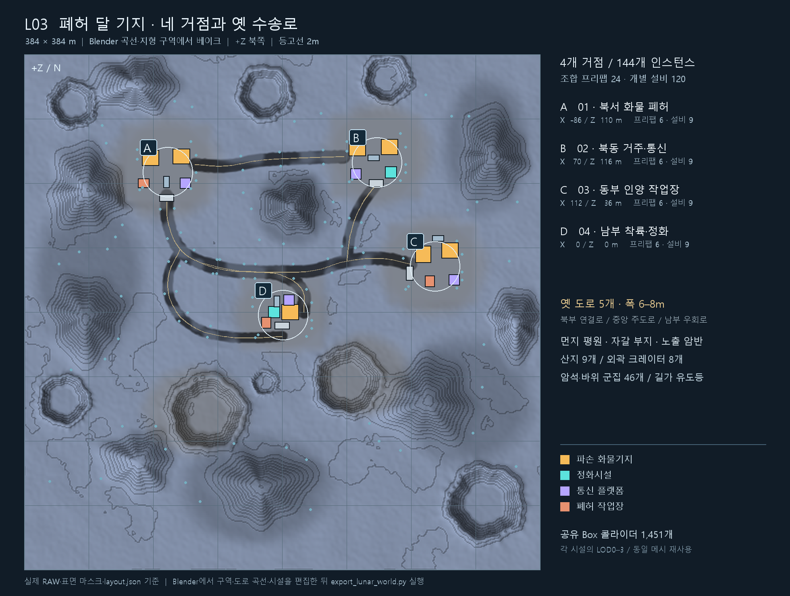

# L03 폐허 달 기지 배치 기준

작성일: 2026-11-16. 작업 카드: `ASSET-L03-WORLD`.
작업 브랜치: `feature/lunar-base-layout`, 분기 기준: `develop` / `4c9941f`.

사용자가 제시한 네 마을과 연결로 스케치를 기준으로 구현한 현재 맵의 배치 명세입니다.
좌표와 수치는 현재 Blender 원본 및 내보낸 데이터를 기준으로 작성했습니다.
교전 밸런스와 팀별 시작 위치는 플레이테스트 후 확정할 항목입니다.

## 좌표계와 수정 기준

- 거리 단위는 m입니다. 아래 평면 좌표는 엔진 `(X, Z)`이며 `+Z`가 북쪽입니다.
- 엔진은 Y가 위, Blender는 Z가 위입니다. Blender `(X, Y, Z)`를 엔진 `(X, Z, Y)`로 내보냅니다.
- 시설 yaw는 엔진 Y축 각도이며 Blender Z축 회전과 부호가 반대입니다. 기존 Box 충돌 때문에 90도 단위만 지원합니다.
- 지형과 시설을 수정하는 원본은 `Assets/LunarKit/source/L02_LunarKit_Layout.blend`입니다.
- 이 문서는 배치 명세입니다. 실행 시 읽는 설정은 아래 JSON·RAW·DDS·TXT와 공유 헤더입니다.

| 결정 내용 | 실제 정의·저장 위치 | Blender 편집 대상 |
| --- | --- | --- |
| 지형 크기·높이 인코딩 | `Shared/World/TestMapSettings.h`, `Assets/Terrain/lunar_craters.json` | 지형 규격 변경은 코드·설정을 함께 수정 |
| 산지·크레이터·도로·부지·재질 구역 | `Assets/Terrain/lunar_craters.json` | `L03_WORLD_Authoring` |
| 마을 시설·암석·소품 위치 | `Assets/LunarKit/layout.json`, `layout.txt` | `L02_LAYOUT_Export_Instances` |
| 초기 마을 배치 계획 | `Assets/LunarKit/settlements.json`, `Tools/author_lunar_base.py` | 기본안 재적용용 |
| 플레이어 시작 위치·실제 정화기 위치 | `Shared/World/TestMapSettings.h` | 공유 헤더에서 수정 |
| 엔진 산출물 | `lunar_craters_r16.raw`, `lunar_surface_mask.dds`, 공유 충돌 TXT | exporter로 생성 |

`settlements.json`과 `author_lunar_base.py`는 초기 계획입니다.
Blender 수동 편집 후의 실제 결과는 `.blend`, `lunar_craters.json`, `layout.json`을 기준으로 확인합니다.

## 터레인 규격

| 항목 | 현재 값 |
| --- | --- |
| 전체 크기 | 384 × 384m, X/Z 각각 -192 ~ +192m |
| 높이맵 해상도·간격 | 513 × 513 표본, 간격 0.75m |
| 형식 | 헤더 없는 little-endian R16_UNORM, 행 방향 +Z, 크기 526,338 bytes |
| 월드 높이 해석 | `Y = RAW / 65535 × 48 - 16` |
| 표현 가능한 높이 | -16 ~ +32m |
| 현재 베이크 높이 | 약 -5.37 ~ +28.39m |
| 도로·거점 기준 높이 | 4.71m, R16 양자화 후 약 4.710277m |
| 시설 바닥 높이 | 지형 최저 높이 + 0.005m, 네 부지는 약 4.715277m |
| 렌더·충돌 | 클라이언트·서버가 같은 R16 사용, 렌더 64청크 × 4 LOD |

큰 지형은 아래 산지·크레이터 좌표에 고정합니다. 작은 표면 굴곡과 먼지 무늬에는 결정적 노이즈를 사용합니다.
베이크 우선순위는 기본 지형 → 산지·크레이터 → 중앙 평탄부 → 거점 부지 → 도로 노반입니다.
부지와 도로를 마지막에 평탄하게 만들어 큰 경사가 주요 이동로를 가로막지 않도록 합니다.

## 산지 9개

반경은 타원의 반축 길이입니다. 높이는 지형에 더하는 형상 파라미터이며 최종 월드 Y가 아닙니다.
Blender `RIDGE_` 가이드의 XY 스케일은 반경, Z 스케일은 높이입니다.

| ID | 중심 X/Z | 반경 X/Z | 높이 파라미터 | 역할 |
| --- | --- | --- | --- | --- |
| RIDGE_01 | -146 / 91 | 35 / 40 | 23 | A 서쪽 외곽 |
| RIDGE_02 | -109 / 170 | 43 / 25 | 21 | A 북쪽 경계 |
| RIDGE_03 | 157 / 117 | 29 / 45 | 23 | B 동쪽 경계 |
| RIDGE_04 | 7 / 79 | 27 / 25 | 23 | 북부·중앙 도로 사이 |
| RIDGE_05 | -147 / -4 | 34 / 43 | 23 | 서부·남부 외곽 |
| RIDGE_06 | 108 / -67 | 46 / 42 | 23 | C 남쪽 산지 |
| RIDGE_07 | -16 / -131 | 48 / 34 | 23 | 남쪽 경계 |
| RIDGE_08 | -107 / -112 | 35 / 30 | 18 | 남서 외곽 |
| RIDGE_09 | 174 / -8 | 22 / 34 | 20 | 동쪽 경계 |

## 크레이터 8개

Blender `CRATER_` 가이드 위치는 중심, X 스케일은 반경입니다.
`depth_m`은 깊이, `rim_m`은 테두리 높이입니다. 불규칙한 형상을 재현하는 `phase`도 JSON에 저장합니다.

| ID | 중심 X/Z | 반경 | 깊이 | 테두리 높이 |
| --- | --- | --- | --- | --- |
| CRATER_01 | -56 / -76 | 27 | 9 | 3.8 |
| CRATER_02 | 49 / -52 | 24 | 8 | 3.4 |
| CRATER_03 | -163 / -66 | 18 | 6 | 2.4 |
| CRATER_04 | 78 / 174 | 17 | 5 | 2.5 |
| CRATER_05 | -13 / 163 | 19 | 6 | 2.8 |
| CRATER_06 | 151 / -143 | 27 | 9 | 3.8 |
| CRATER_07 | -156 / 155 | 16 | 5 | 2.6 |
| CRATER_08 | -13 / -53 | 9 | 2.5 | 1.2 |

## 바닥 재질 구역

기본 바닥은 월면 먼지입니다. 거점·크레이터 주변은 자갈, 산지·외곽은 노출 암반으로 나눕니다.
도로는 자갈 기반의 어두운 다짐면에 먼지가 덮인 모습입니다. 큰 경사에는 법선 기반 암반도 적용합니다.

| Blender 가이드 | 재질 | 중심 X/Z | 반경 X/Z |
| --- | --- | --- | --- |
| SURFACE_01_gravel | 자갈 | -87 / 107 | 46 / 42 |
| SURFACE_02_gravel | 자갈 | 72 / 118 | 43 / 42 |
| SURFACE_03_gravel | 자갈 | 112 / 34 | 44 / 41 |
| SURFACE_04_gravel | 자갈 | 0 / 0 | 39 / 34 |
| SURFACE_05_gravel | 자갈 | -65 / -74 | 42 / 36 |
| SURFACE_06_gravel | 자갈 | 61 / -47 | 37 / 33 |
| SURFACE_07_rock | 암반 | -144 / 28 | 44 / 64 |
| SURFACE_08_rock | 암반 | 8 / 78 | 31 / 31 |
| SURFACE_09_rock | 암반 | 137 / -66 | 54 / 52 |
| SURFACE_10_rock | 암반 | -20 / -132 | 60 / 44 |
| SURFACE_11_rock | 암반 | 152 / 124 | 34 / 55 |

거점 부지에도 자갈 가중치를 더합니다. 표면 DDS의 R/G/B는 각각 도로/자갈/암반입니다.
PNG는 Blender UV에 맞춘 북쪽 위 이미지, DDS는 DirectX UV에 맞춘 -Z 첫 행입니다.

## 마을 4개와 부지

각 마을은 여러 독립 건물과 열린 마당으로 구성합니다. 출입구, 파손 벽과 복도에 이동 통로를 남깁니다.

| 거점 | 역할 | 중심 X/Z | 평탄 부지 전체 크기 X/Z | 부지 밖 높이 전이폭 |
| --- | --- | --- | --- | --- |
| A | 북서 화물 폐허 | -86 / 110 | 58 / 52 | 9 |
| B | 북동 거주·통신 | 70 / 116 | 60 / 54 | 9 |
| C | 동부 인양 작업장 | 112 / 36 | 58 / 52 | 9 |
| D | 남부 착륙·정화, 시작 기지 | 0 / 0 | 54 / 48 | 9 |

부지 전체 크기는 Blender `PAD_` 가이드 XY 스케일의 두 배입니다. 기준 높이는 모두 4.71m입니다.

### 시설 프리팹 24개

위치는 프리팹 원점입니다. 현재 Y는 모두 약 4.715277m입니다.
정화시설 프리팹은 환경 모델이며 실제 F키 정화는 D의 별도 NR01 정화기가 담당합니다.

| 거점 | 시설 프리팹 | 원점 X/Z | 엔진 yaw(도) |
| --- | --- | --- | --- |
| A | CargoDepot_Ruined | -98 / 115 | 0 |
| A | CargoDepot_Ruined | -75 / 116 | 0 |
| A | WreckWorkshop | -103 / 96 | 0 |
| A | RelayPlatform | -72 / 96 | 0 |
| A | ServiceCorridor | -86 / 97 | 0 |
| A | CoverCheckpoint | -86 / 85 | 0 |
| B | CargoDepot_Ruined | 56 / 122 | 0 |
| B | CargoDepot_Ruined | 80 / 123 | 0 |
| B | PurificationStation | 81 / 104 | 0 |
| B | RelayPlatform | 55 / 103 | 0 |
| B | ServiceCorridor | 68 / 115 | 90 |
| B | CoverCheckpoint | 70 / 96 | 0 |
| C | CargoDepot_Ruined | 105 / 43 | 90 |
| C | CargoDepot_Ruined | 125 / 46 | 0 |
| C | WreckWorkshop | 110 / 23 | 90 |
| C | RelayPlatform | 128 / 24 | 0 |
| C | ServiceCorridor | 116 / 55 | 90 |
| C | CoverCheckpoint | 95 / 29 | 90 |
| D | CargoDepot_Ruined | 6 / 0 | 0 |
| D | PurificationStation | -6 / 0 | 0 |
| D | RelayPlatform | 5 / 9 | 0 |
| D | ServiceCorridor | -4 / 8 | 0 |
| D | CoverCheckpoint | 0 / -10 | 0 |
| D | WreckWorkshop | -12 / -8 | 90 |

추가로 거점 설비·잔해 36개, 도로 비콘 38개, 암석·바위 군집 46개를 배치했습니다.
총 144개 인스턴스와 공유 Box 충돌체 1,451개입니다. 개별 소품 좌표는 `layout.json`에 있습니다.

## 길 5개와 연결 구조

도로는 Blender Bezier 곡선으로 편집합니다. 아래는 주요 제어점이며 양쪽 핸들과 샘플 중심선은 JSON에 저장합니다.
길이는 내보낸 중심선 기준 근삿값입니다. 도로 노반 높이는 모두 4.71m, 바깥 높이 전이폭은 7m입니다.

| ID | 연결·역할 | 폭 | 길이(약) |
| --- | --- | --- | --- |
| ROAD_01_North_Link | A ↔ B 북부 연결로 | 8 | 111.5 |
| ROAD_02_West_Service | A ↔ 중앙 분기 ↔ D 서부 주도로 | 8 | 158.3 |
| ROAD_03_East_Service | 서부 주도로 분기 ↔ C 동부 주도로 | 8 | 159.3 |
| ROAD_04_Relay_Spur | B ↔ 동부 주도로 진입로 | 7 | 61.0 |
| ROAD_05_Old_South_Loop | 서부 주도로 분기 ↔ D 남부 우회로 | 6 | 134.6 |

- `ROAD_01_North_Link`: `(-65,110) → (-42,109) → (-18,113) → (15,115) → (46,116)`.
- `ROAD_02_West_Service`: `(-86,87) → (-85,67) → (-76,47) → (-61,37) → (-39,31) → (-18,30) → (1,27) → (15,16) → (16,0)`.
- `ROAD_03_East_Service`: `(-61,37) → (-34,31) → (-6,30) → (23,31) → (48,38) → (74,40) → (96,36)`.
- `ROAD_04_Relay_Spur`: `(69,94) → (58,78) → (51,59) → (48,38)`.
- `ROAD_05_Old_South_Loop`: `(-76,47) → (-85,25) → (-81,4) → (-66,-11) → (-43,-18) → (-18,-19) → (0,-18)`.

유도등은 도로 중심에서 `폭/2 + 1.4m`만큼 옆에 둡니다.
B 검문소는 `(70,96)`, C 검문소는 `(95,29)`로 두어 도로 중심선을 가로막지 않게 했습니다.

## 플레이어 시작 위치와 정화기

| 항목 | 현재 결정값 | 적용 위치 |
| --- | --- | --- |
| 시작 거점 | D / 남부 착륙·정화 기지 | 맵 배치 |
| 초기 발 위치 X/Y/Z | `(-5, 0, 0)` | `TestMapSettings::PLAYER_SPAWN_POSITION_M` |
| 초기 높이 처리 | 공유 충돌 보정으로 지형·시설 바닥에 올림 | `ResolveCharacterContactsInWorld` |
| 실제 NR01 정화기 원점 X/Y/Z | `(-16, 4.4, 4)` | `TestMapSettings::PURIFIER_POSITION_M` |
| 정화 발 위치 판정 중심(정화기 로컬) | `(0, 0.642, 0.035)` | `PURIFIER_INTERACT_FEET_CENTER_M` |
| 정화 판정 여유 | XZ 반경 0.73m, 높이 오차 0.14m | 공유 설정, 서버 재검증 |

시작 Y=0은 초기 입력값이며 최종 접지 높이가 아닙니다. 클라이언트와 서버는 같은 공유 헤더에서 시작 위치를 읽습니다.
시작 위치를 바꿀 때는 시설 배치·진입 동선·정화기 접근성을 함께 확인합니다.
카메라 시작 방향, 플레이어별 스폰 슬롯과 팀별 시작 위치는 이 작업에서 새로 정하지 않았습니다.

## 수정 후 적용 순서

1. Blender 원본에서 지형 가이드와 시설을 수정합니다. 시설은 스케일 1, Z축 90도 회전을 유지합니다.
2. 내장 `export_lunar_world.py`를 실행합니다. 지형 RAW, 표면 PNG/DDS, 배치, 공유 충돌,
   건물·도로 검사 경로와 `.blend`를 함께 저장합니다.
3. 시작 위치·실제 정화기 위치를 바꾸면 공유 헤더도 수정하고 클라이언트·서버를 다시 빌드합니다.
4. 게임을 재시작합니다. 엔진은 `.blend` 대신 내보낸 RAW/DDS/OBJ/TXT를 읽습니다.
5. 검증을 실행하고 이 문서의 좌표·수치를 갱신합니다.

`author_lunar_base.py --apply-plan`은 초기 기본안으로 되돌리는 명령입니다.
수동 편집을 적용할 때는 `export_lunar_world.py`를 사용합니다.
Blender 조작 상세는 [모듈 키트 사용법](lunar-modular-kit.md)에 있습니다.

## 검증과 남은 확인

- 최신 `develop` 패치와 맵 작업을 합친 Client/Server Debug x64 빌드.
- `TerrainTests`: 지형 64청크 × 4 LOD, 경계 연결과 렌더/충돌 높이 정합.
- `LunarKitTests`: OBJ 196개, DDS, 공유 충돌, 건물 경로 13개와 중앙 통로·도로 5개 양방향 이동.
- Blender `validate_lunar_kit.py`: 원본·엔진 배치·충돌 일치, 전체 R16 높이,
  표면 마스크 방향·색 공간, Bezier 재생성, 파츠와 exporter 검사.
- `validate_lunar_access.py`: 144개 배치의 지형 접근 영역 연결.
- Blender 전체·거점·도로 렌더 확인. 실제 온라인 다인 플레이의 교전 밸런스와 동선 체감은 팀 리뷰 대상입니다.

실행 명령은 [모듈 키트 문서의 검증 절](lunar-modular-kit.md#검증)을 참고합니다.
